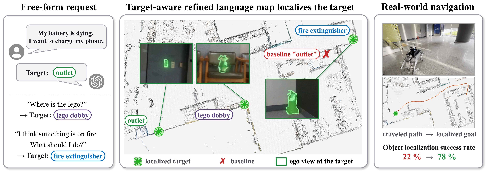

# Training-Free Target-Aware Refinement of 3D Gaussian Language Map

[Sibaek Lee](https://sibaek-lee.github.io/)1,
[Kyeongsu Kang](https://sites.google.com/view/thithin/)1,
[Seongbo Ha](https://riboha.github.io/)1,
[Yewon Jeon](https://yyonyy.github.io/)1,
[Joonyeol Choi](https://joonyeolchoiskku.github.io/)1,
[Daegeol Ko](https://daegeol.github.io/)1,
[Jaehyuk Hur](https://broadleaf-option-c34.notion.site/Jaehyuk-Hur-34660dadf71c4d3db77919610432e5c5)1, 
Taemin Choi2,
Minsu Kim2,
Hyungjoo Ahn2,
Wonsok Yoo2,
[Hyeonwoo Yu](https://bogus2000.github.io/)1

1Sungkyunkwan University &nbsp;&nbsp; 2Samsung Electronics

## Overview

We propose a training-free, target-aware refinement of an already-distilled 3D Gaussian language map. Guided by a text-promptable segmenter, the visual embedding inside each detected target region is blended with the target text embedding, with each target's injection strength obtained in closed form, so no hyperparameters need to be tuned. A centered read-out removes the query-agnostic bias that injection introduces, turning the refined map into a reliable source of language-goal locations for robot navigation.

## Code

Code will be released soon.
